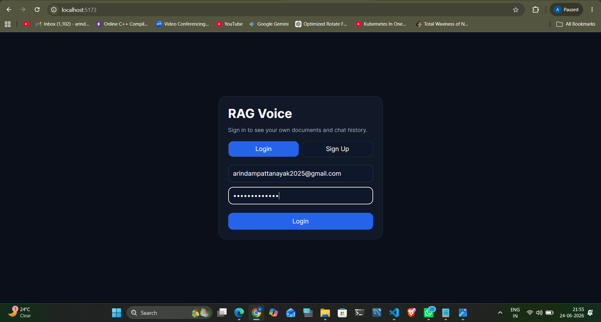
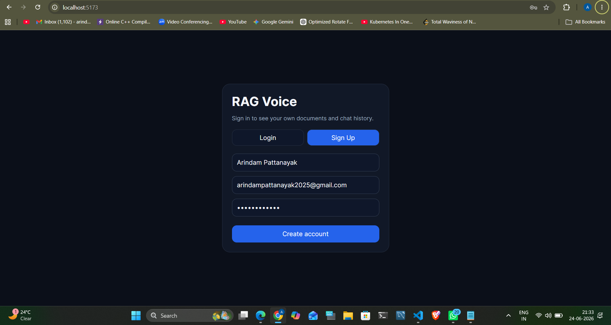
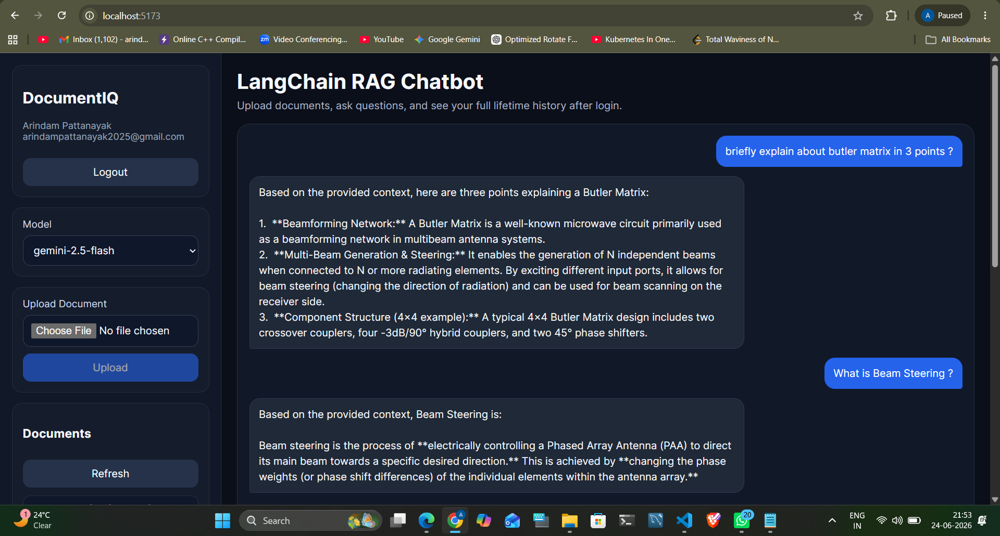
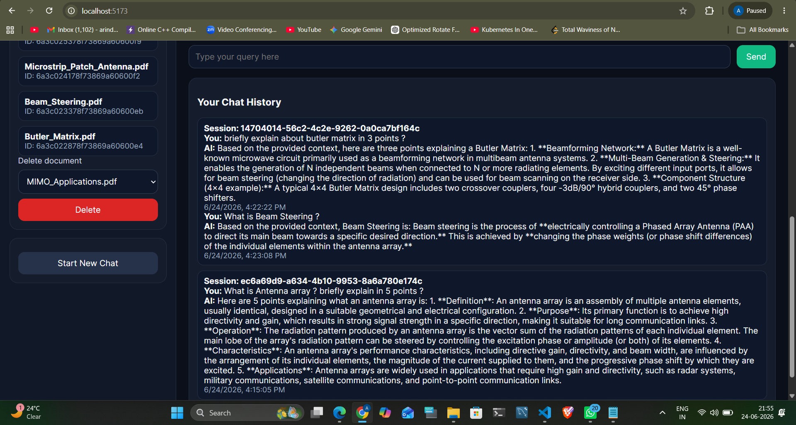

# AI Documentation Chat Assistant

An AI-powered Retrieval-Augmented Generation (RAG) web application that lets users upload documents (`PDF`, `DOCX`, `HTML`), index them into a semantic vector store, and chat with their knowledge base using natural language.

---

## Table of Contents

- [Overview](#overview)
- [Key Features](#key-features)
- [Architecture & Tech Stack](#architecture--tech-stack)
- [Project Structure](#project-structure)
- [Screenshots](#screenshots)
- [Prerequisites](#prerequisites)
- [Environment Configuration](#environment-configuration)
- [Getting Started](#getting-started)
- [Author](#author)

---

## Overview

**AI Documentation Chat Assistant** combines semantic vector retrieval via **ChromaDB** and **HuggingFace embeddings (`all-MiniLM-L6-v2`)** with **Google Gemini (`gemini-2.5-flash`)** orchestrated through **LangChain**. Users can sign up, manage their uploaded documents, ask context-aware questions across sessions, and revisit persistent conversation history stored in **MongoDB**.

---

## Key Features

- **Multi-Format Document Ingestion**: Upload and index `PDF`, `DOCX`, and `HTML` files.
- **Semantic Vector Search**: Chunking via `RecursiveCharacterTextSplitter` and dense embeddings stored in ChromaDB.
- **Context-Aware Q&A**: History-aware retrieval and response generation powered by Gemini 2.5 Flash.
- **User Authentication**: JWT-based signup/signin flow with password hashing.
- **Persistent Chat History**: Multi-session conversations and document metadata stored in MongoDB.
- **Document Management**: View and delete indexed documents per user.
- **Modern Web UI**: Responsive React + Vite frontend paired with a FastAPI backend.

---

## Architecture & Tech Stack

| Layer | Technology | Role |
| :--- | :--- | :--- |
| **Frontend** | React, Vite, Axios | Interactive chat UI, auth panel, document sidebar, and session history |
| **Backend** | FastAPI, Uvicorn | REST API, JWT authentication, file upload, and RAG orchestration |
| **LLM** | Google Gemini 2.5 Flash | Context-grounded answer generation |
| **RAG Framework** | LangChain | Document loaders, text splitting, history-aware retriever, and chains |
| **Embeddings** | `all-MiniLM-L6-v2` | Sentence-Transformers vector embeddings |
| **Vector Database** | ChromaDB | Persistent semantic similarity search |
| **Database** | MongoDB / MongoDB Atlas | User accounts, document records, and chat logs |

---

## Project Structure

```text
AI-Documentation-Chat-Assistant/
├── Images/                  # Application screenshots
├── backend/
│   ├── requirements.txt     # Python dependencies
│   └── src/
│       ├── main.py          # FastAPI app & endpoints (/chat, /upload-doc, etc.)
│       ├── auth_routes.py   # Signup & login routes
│       ├── auth_utils.py    # JWT & password hashing helpers
│       ├── dependencies.py  # Auth dependencies
│       ├── db_utils.py      # MongoDB connection & queries
│       ├── chroma_utils.py  # Document loading, chunking & ChromaDB indexing
│       ├── langchain_utils.py # History-aware RAG chain
│       └── pydantic_models.py # Request/response schemas
├── frontend/
│   ├── package.json         # Node dependencies
│   └── src/
│       ├── App.jsx          # Main application layout
│       ├── api.js           # Axios API client
│       └── components/      # AuthPanel, Sidebar, ChatWindow, ChatInput, HistoryPanel
└── README.md
```

---

## Screenshots

| Login | Signup |
| :---: | :---: |
|  |  |

| AI Response | Chat History |
| :---: | :---: |
|  |  |

---

## Prerequisites

- **Python** 3.11+
- **Node.js** & **npm**
- **MongoDB** (Local instance or MongoDB Atlas)
- **Google Gemini API Key**

---

## Environment Configuration

Create a `.env` file inside `backend/`:

```env
DB_URI=your_mongodb_connection_string
DB_NAME=documentiq
GEMINI_API_KEY=your_gemini_api_key
GEMINI_MODEL=gemini-2.5-flash
RETRIEVER_K=5
LLM_TEMPERATURE=0.7
FRONTEND_URL=http://localhost:5173
SECRET_KEY=your_secret_key
ALGORITHM=HS256
ACCESS_TOKEN_EXPIRE_MINUTES=1440
```

---

## Getting Started

### 1. Clone the Repository

```bash
git clone https://github.com/Siddartharekanti/AI-Documentation-Chat-Assistant.git
cd AI-Documentation-Chat-Assistant
```

### 2. Backend Setup

```bash
python -m venv venv
source venv/bin/activate   # On Windows: venv\Scripts\activate
pip install -r backend/requirements.txt

cd backend
uvicorn src.main:app --reload
```

Backend runs at: `http://localhost:8000`

### 3. Frontend Setup

Open a new terminal:

```bash
cd frontend
npm install
npm run dev
```

Frontend runs at: `http://localhost:5173`

---

## Author

**Siddartha**
